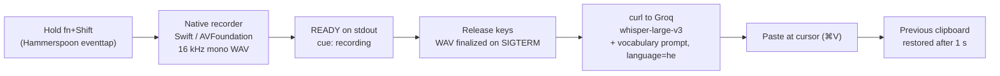
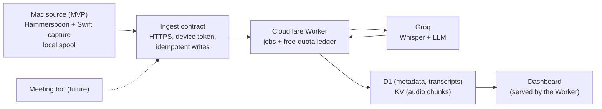

# Hebrew Dictation for macOS

Hold a key, speak Hebrew, release: the transcribed text is pasted wherever your cursor is, in any app.


---

## Overview

Dictating Hebrew should be as quick as typing it, including the Hebrew-English technical jargon
that software teams actually speak ("הדיפלוי לפרודקשן", "צ׳קאאוט", "הבאג"), which general-purpose
transcription tends to mangle. This project is a small, dependency-light tool for that:

- **For** Hebrew speakers who write a lot on a Mac: developers, product people, anyone who
  would rather talk than type.
- **How:** a Hammerspoon hotkey drives a native Swift recorder; audio is transcribed by
  Groq's hosted `whisper-large-v3` with a vocabulary-biasing prompt, and the text is pasted at
  the cursor.
- **Speed:** about **0.6 s** from key release to pasted text on short dictations (measured).
  Longer recordings take longer, since upload and transcription time grow with audio length.

The full user guide in Hebrew is at [docs/he/README.md](docs/he/README.md).

## Features

### Implemented

- **Push-to-talk in any app.** Hold `fn+Shift`, speak, release. The text is pasted at the cursor
  with `⌘V`.
- **Clipboard preserved.** The previous clipboard text is restored one second after the paste.
- **Low-latency native recorder.** A purpose-built Swift/AVFoundation helper opens the mic in
  about 0.5 s, versus 1.4–3.5 s with `ffmpeg` (measured).
- **Honest on-screen cues.** "⏳ מתחבר" (connecting) while the mic is still opening;
  "🎙️ מקליט" (recording) only once the recorder reports that audio is actually flowing.
- **Mic priming.** Pressing `fn` alone starts opening the mic early, which hides most of the
  open latency. If the combo is not completed, the recording is killed and deleted, never sent.
- **Vocabulary-biasing prompt** for Hebrew tech jargon, at no extra latency.
- **Hebrew pinned by default**, with any ISO-639-1 code or auto-detect available.
- **Accidental-tap filter.** Holds shorter than 0.35 s are discarded.
- **Diagnostics.** An in-memory log of every dictation (returned text and release-to-paste time),
  readable from Terminal, plus an opt-in recording archive and a script that replays a recording
  through several transcription engines side by side.
- **One-command installer** that builds the recorder, stores the API key with mode `600`, and
  wires the Hammerspoon config, backing up any existing `init.lua` first.

### In development / Planned: meeting notetaker

A meeting notetaker is designed and planned as a separate module next to dictation: it will
record Zoom and Google Meet calls on the Mac as two tracks (your mic and the other participants),
transcribe them in a free-tier Cloudflare Worker, extract a summary, decisions and action items
that must each cite transcript evidence, and show them in a web dashboard.

**The notetaker is not usable yet.** No notetaker code exists in this repository today. Status of
the [implementation plan](docs/superpowers/plans/2026-10-29-meeting-notetaker.md):

| Stage | Scope | Status |
|---|---|---|
| 0 | Safety baseline, accounts, Worker skeleton, KV/CPU/FTS spike | In progress |
| 1 | Mac capture: two-track `meeting-recorder`, Lua module, installer | Planned |
| 2 | Transcription language strategy and model evaluation | Planned |
| 3 | Cloud backbone: D1 schema, ingest API, jobs, free-quota ledger, uploader | Planned |
| 4 | AI analysis with evidence validation | Planned |
| 5 | Auto-detection of meetings and consent tooling | Planned |
| 6 | Dashboard | Planned |
| 7 | Hardening and a week of real use | Planned |

## Demo

No screenshots or recordings are published yet. Demos will be added as features ship.

## Architecture

### Current: dictation pipeline



### Planned: meeting notetaker

> **Planned design, not implemented.** See the [design spec](docs/superpowers/specs/2026-10-29-meeting-notetaker-design.md).



More detail: [docs/architecture.md](docs/architecture.md).

## Engineering highlights

Every number below was measured during development and is recorded in the source comments or
the original user guide.

- **~0.6 s from key release to pasted text** on short dictations. Longer recordings scale with
  audio length.
- **Mic-open time: 1.4–3.5 s → ~0.5 s.** `ffmpeg -f avfoundation` was slow to open the input
  device; on a 2–4 s dictation that swallowed most of the sentence and looked like a
  transcription-quality problem. A small native recorder fixed it.
- **Vocabulary prompt: 3/3 test sentences exact.** Without it, jargon came out mangled
  ("הבאג" → "הבואג", "צ׳קאאוט" → "צ'יקאות", "הדיפלוי לפרודקשן" → "הדיפלויל פרודקשן").
- **LLM cleanup rejected on evidence.** A `llama-3.3-70b` cleanup pass silently rewrote
  "צ׳קאאוט" into "בדיקות", a meaning change that is worse than the original error because it
  cannot be spotted. Biasing the transcriber can only choose better words; it cannot invent content.

Each decision is written up with its context and consequences in
[docs/engineering-decisions.md](docs/engineering-decisions.md).

## How the notetaker extends dictation without breaking it

*Planned. Full strategy in [docs/architecture.md](docs/architecture.md#additive-integration-and-rollback-planned).*

- **One integration line.** The only change to the existing Hammerspoon config will be one
  appended line, `pcall(require, "notetaker")`. Dictation loads first, and a notetaker load
  error cannot stop it.
- **Isolated files and globals.** Notetaker files live under their own paths; its only global is
  `_G.notetaker`; it has its own recorder binary, spool and temp paths, and uses no dictation
  hotkey or global.
- **Flags off by default.** `enabled`, `autoRecord`, `upload` and `echoCancel` all start off;
  paid processing in the Worker starts disabled.
- **Baseline regression guards.** Snapshots of protected files, hotkeys and globals, plus a
  dictation smoke test, will be checked after every install.
- **Staged rollout with human approval gates.** Every deploy, install and merge to `main` needs
  explicit approval, and rollback is as light as deleting that one line.

## Tech stack

| | |
|---|---|
| **Current** | Hammerspoon (Lua), Swift / AVFoundation, Groq Whisper (`whisper-large-v3`), curl, bash |
| **Planned** | Cloudflare Workers, D1, KV, TypeScript, Vitest, Core Audio process taps |

## Installation

### Requirements

- macOS
- [Hammerspoon](https://www.hammerspoon.org): `brew install --cask hammerspoon`
- Xcode Command Line Tools (for `swiftc`): `xcode-select --install`
- A Groq API key ([console.groq.com/keys](https://console.groq.com/keys); a free tier is available)

### Install

```bash
git clone <repo-url> hebrew-dictation
cd hebrew-dictation
./install.sh
```

The installer, in order:

1. Checks prerequisites and builds the recorder into `~/.hammerspoon/bin/`.
2. Asks for your Groq key and stores it at `~/.config/dictation-groq-key` with mode `600`. If a
   key is already saved there, it is left alone and the question is skipped.
3. Installs `dictation.lua` into `~/.hammerspoon/` and loads it from `init.lua`:
   - no `init.lua` yet → one is created with `require("dictation")`;
   - an `init.lua` that already mentions dictation → left untouched, with no backup;
   - any other `init.lua` → backed up with a timestamp, then `require("dictation")` is appended.

The key is never written into the code. **Never commit it;** `.gitignore` excludes the key file
names as a safeguard.

### Two manual permissions

macOS does not allow a script to grant these:

- **System Settings → Privacy & Security → Accessibility** → enable Hammerspoon
- **System Settings → Privacy & Security → Microphone** → enable Hammerspoon

Then launch Hammerspoon, or reload it with `Ctrl+Cmd+R`.

## Usage

Hold `fn+Shift`, speak, release. The text is pasted at the cursor.

There are two on-screen cues, and they mean different things:

| Cue | Meaning |
|---|---|
| ⏳ מתחבר (connecting) | The mic is still opening. **Anything said now is lost.** |
| 🎙️ מקליט (recording) | Audio is actually being captured. Speak. |

**Tip:** press `fn` a moment before `Shift`. The mic starts opening on `fn`, and the wait almost
disappears.

## Configuration

After installation, the live configuration is `~/.hammerspoon/dictation.lua`. Reload with
`Ctrl+Cmd+R` after editing.

| Setting | Default | Purpose |
|---|---|---|
| `VOCAB_PROMPT` | Hebrew tech terms | Biases Whisper's vocabulary. Add names of people, clients and products the engine keeps getting wrong. Costs no latency. |
| `LANGUAGE` | `"he"` | Pinned on purpose: auto-detect (`nil`) made real-world Hebrew worse. Any ISO-639-1 code works. |
| `KEEP_RECORDINGS` | `false` | When `true`, keeps the 20 most recent recordings in `~/.hammerspoon/recordings/` for diagnostics. |

To change the hotkey, edit `isExactFnShift` and `isPrimingModifierOnly`. Do not prime the mic on
`Shift` alone; see [the decision record](docs/engineering-decisions.md#adr-002-prime-the-mic-on-fn-alone-never-on-shift).

## Troubleshooting

Read the dictation log from Terminal (each entry records the returned text and the
release-to-paste time):

```bash
hs -c 'for _,l in ipairs(_G.dictationLog) do print(l) end' | tail -20
```

| Symptom | Cause |
|---|---|
| "ההקלטה לא נקלטה" (recording not captured) | Hammerspoon lacks Microphone permission |
| Nothing happens on the hotkey | Hammerspoon lacks Accessibility permission |
| The start of the sentence is cut off | Speech began during ⏳. Wait for 🎙️ |
| Text appears when you said nothing | Whisper invents text from silence (often "Thank you"), a known model behavior |

### Comparing transcription engines

Set `KEEP_RECORDINGS = true`, dictate a few times, then run:

```bash
~/.hammerspoon/bin/compare-transcribers.sh [file.wav]
```

It replays the most recent recording (or the given file) through Groq `whisper-large-v3` with and
without the vocabulary prompt, `whisper-large-v3-turbo`, and ElevenLabs Scribe if a key exists at
`~/.config/dictation-elevenlabs-key`, and prints the results side by side. It uses `python3`,
`ffprobe` and `ffmpeg` for parsing and audio stats.

## Project structure

```
.
├── dictation.lua                 Hammerspoon module: hotkey, priming, upload, paste
├── bin/
│   ├── dictation-recorder.swift  native low-latency recorder (built by install.sh)
│   └── compare-transcribers.sh   replay a recording through several engines
├── install.sh                    builds the recorder, stores the key, wires Hammerspoon
├── docs/
│   ├── README.md                 documentation index
│   ├── architecture.md
│   ├── engineering-decisions.md
│   ├── he/README.md              original Hebrew user guide
│   └── superpowers/              notetaker design spec and implementation plan
├── notetaker/                    (planned, does not exist yet)
│   ├── mac/                      Hammerspoon module + meeting-recorder
│   ├── worker/                   Cloudflare Worker + dashboard
│   ├── eval/                     language/model evaluation
│   └── tests/                    guards and test runners
├── LICENSE
└── README.md
```

## Testing and quality

- **Today:** there is no automated test suite. Quality is checked with manual measurement:
  release-to-paste timing in the dictation log, the recorder's `DICTATION_TIMING` breakdown, and
  `compare-transcribers.sh` for side-by-side engine comparisons on real recordings.
- **In progress:** baseline regression guards for dictation (plan Task 0.1): snapshot and verify
  scripts for protected files, hotkeys and globals, a repo no-touch check, an isolation lint and a
  dictation smoke test.
- **Planned:** Vitest suites for the Worker (local D1/KV, mocked Groq), plain Lua unit tests for the
  notetaker's pure logic, scripted recorder tests, and a separate builder and verifier review for
  every task.

## Privacy and security

- **The mic opens only while you are pressing toward the hotkey,** never in the background.
  Pressing `fn` alone primes it; if `Shift` does not follow, the recorder is killed and its file
  deleted without being sent anywhere.
- **Audio is sent to Groq** for transcription. See [Groq's privacy policy](https://groq.com/privacy-policy/).
- **Recordings are not kept on disk** unless `KEEP_RECORDINGS = true`.
- **The API key** lives at `~/.config/dictation-groq-key` with mode `600`, outside the repo and
  outside the code.
- **No recordings or keys in git.** `.gitignore` excludes key files, audio files and recording
  folders.

## Roadmap

The meeting notetaker is the next major feature. See the
[implementation plan](docs/superpowers/plans/2026-10-29-meeting-notetaker.md) and the
[design spec](docs/superpowers/specs/2026-10-29-meeting-notetaker-design.md).

## Documentation

- [Documentation index](docs/README.md)
- [Architecture](docs/architecture.md)
- [Engineering decisions](docs/engineering-decisions.md)
- [Hebrew user guide / מדריך בעברית](docs/he/README.md)

## License

[MIT](LICENSE)
