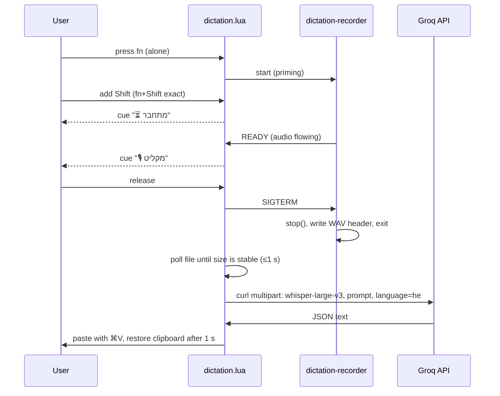
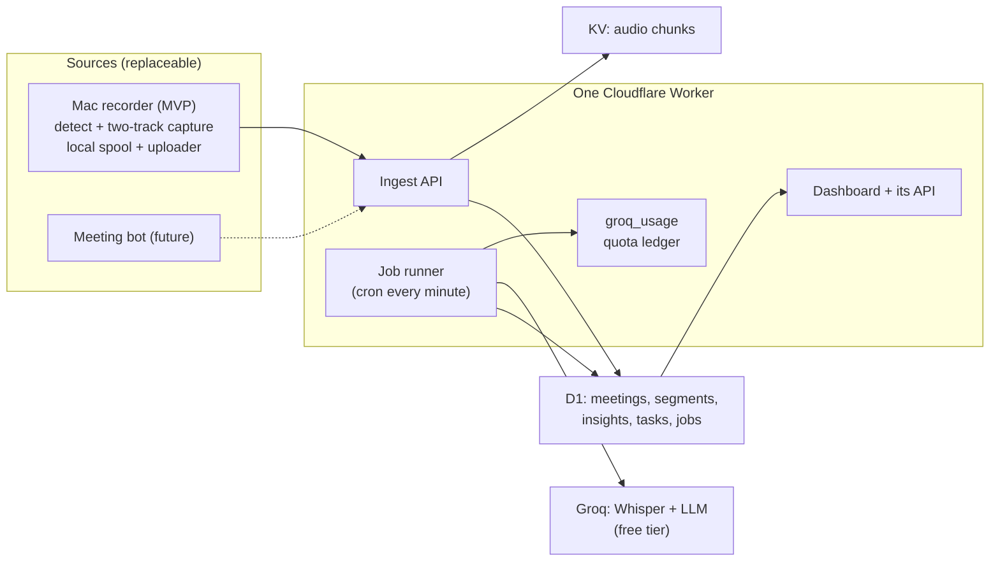

# Architecture

This document covers the dictation pipeline as it works today, the planned meeting-notetaker
architecture, and the strategy for adding the notetaker without affecting dictation.

- [Current: dictation pipeline](#current-dictation-pipeline)
- [Planned: meeting notetaker](#planned-meeting-notetaker)
- [Additive integration and rollback (planned)](#additive-integration-and-rollback-planned)

---

## Current: dictation pipeline

Three components, all in this repository:

| Component | File | Role |
|---|---|---|
| Hammerspoon module | [`dictation.lua`](../dictation.lua) | Hotkey state machine, recorder lifecycle, upload, paste, logging |
| Native recorder | [`bin/dictation-recorder.swift`](../bin/dictation-recorder.swift) | Opens the mic quickly and writes 16 kHz mono 16-bit PCM WAV until SIGTERM |
| Engine comparison | [`bin/compare-transcribers.sh`](../bin/compare-transcribers.sh) | Replays a saved recording through several engines for side-by-side comparison |

[`install.sh`](../install.sh) builds the recorder with `swiftc -O` into `~/.hammerspoon/bin/`,
copies `dictation.lua` into `~/.hammerspoon/`, stores the Groq key, and adds `require("dictation")`
to `init.lua`.

### Flow



### Key behaviors

**Hotkey and priming.** A `flagsChanged` eventtap classifies modifier state on every change:

- exactly `fn+Shift` (no Cmd/Alt/Ctrl) → start a dictation;
- `fn` alone → prime: start the recorder early, before the combo is complete;
- anything else → stop and transcribe if recording; cancel if only primed.

A cancelled prime kills the recorder (terminate, then `kill -9`) and deletes the file. The
deletion is repeated in the recorder's exit callback, because the recorder can still be
finishing its device open after `terminate()`, and an early delete raced against a file that
reappeared moments later.

**Recorder.** `AVAudioRecorder` with linear PCM, 16 kHz, mono, 16-bit. After `record()` returns
it prints `READY` on stdout. SIGTERM/SIGINT are handled through `DispatchSource` signal sources so
the handler can call `recorder.stop()`, which writes a valid WAV header, before exiting. Setting
`DICTATION_TIMING` prints init/prepare/record timings to stderr.

**READY and the cue.** `READY` is consumed by the streaming callback passed as `hs.task.new`'s third
argument (setting it afterwards with `setStreamingCallback()` never fired). Only then does the
cue switch from "connecting" to "recording".

**Release.** Holds under 0.35 s are discarded. Otherwise the recorder is terminated gently, and
the module polls the WAV every 30 ms until its size is stable (or 1 s passes) instead of sleeping
a fixed 0.4 s. The poll timer is held at module scope; see
[ADR-006](engineering-decisions.md#adr-006-hold-timers-at-module-scope).

**Upload.** `curl` posts to Groq's OpenAI-compatible transcription endpoint with
`model=whisper-large-v3`, the `VOCAB_PROMPT`, and `language=he` (omitted when `LANGUAGE = nil`).
The response is parsed for `text`; auth errors, network errors, empty text and unexpected
responses each get their own on-screen message.

**Paste.** The previous clipboard text is saved, the transcript is placed on the clipboard,
`⌘V` is sent, and the previous text is restored after 1 s.

**Diagnostics.** `_G.dictationLog` keeps the last 200 log lines, including the release-to-paste
time of each dictation. With `KEEP_RECORDINGS = true`, a copy of each upload is archived
asynchronously (after the upload is in flight) and pruned to the 20 newest.

### Measured performance

- About 0.6 s from key release to pasted text on short dictations. Longer recordings take longer,
  since upload and transcription time grow with audio length.
- Mic-open time about 0.5 s with the native recorder, versus 1.4–3.5 s with `ffmpeg -f avfoundation`.

---

## Planned: meeting notetaker

> **Status: designed, not implemented.** This section summarizes the
> [design spec](superpowers/specs/2026-10-29-meeting-notetaker-design.md); the
> [implementation plan](superpowers/plans/2026-10-29-meeting-notetaker.md) breaks it into
> Stages 0–7. Stage 0 is in progress; nothing below is usable yet.

### Goal

Record Zoom and Google Meet calls on the Mac, transcribe Hebrew, English and mixed speech, and
turn each meeting into a summary, decisions and action items, each linked to transcript
evidence, browsable in a web dashboard. The MVP must cost nothing. A future meeting bot must be
able to feed the same pipeline without changes to transcription, analysis, storage or the
dashboard.

### Shape



### Mac source

- **`meeting-recorder`**: a new Swift helper, separate from `dictation-recorder` and modelled on
  it (READY line, clean finalization on SIGTERM, timing env var). It captures two tracks on one
  clock: `self` (mic via AVAudioEngine) and `others` (a Core Audio process tap on the meeting app).
  It writes AAC `.m4a` chunks of about 5 minutes, cut at the quietest point within ±15 s, to a
  local spool.
- **`notetaker.lua`**: a Hammerspoon controller that detects meetings (Meet/Zoom tab URL or Zoom
  desktop, plus mic in use), shows a cancellable 10-second countdown and a menubar indicator, and
  runs an uploader that drains the spool with `hs.task` + `curl` and exponential backoff.
- Local chunks are deleted only after the server reports them **transcribed**, not just uploaded.

### Ingest contract (the seam)

Every source speaks the same idempotent HTTPS contract, authenticated with a per-device token
(only its hash is stored server side):

1. `POST /api/meetings`: create a meeting, idempotent on a source-generated `client_meeting_id`.
2. `PUT /api/meetings/:id/chunks/:track/:seq`: upload one audio chunk. A same-hash re-upload is a
   no-op; a different hash is rejected.
3. `POST /api/meetings/:id/finalize`: declare the last chunk per track.
4. `GET /api/meetings/:id/chunks/status`: which chunks are transcribed.

A source never calls Groq or writes transcripts. A track is just a labelled audio stream (`self`,
`others`, or `speaker:<name>` from a bot), so the bot is "another source", not a rebuild.

### Pipeline

- **Jobs** live in a D1 table. Uploads trigger processing immediately, and a per-minute cron
  picks up anything pending or due. One unit of work per job keeps each run within the Workers
  CPU limit.
- **Free-only by construction.** A `groq_usage` ledger is checked before every Groq call. When the
  free allowance is used up, or Groq returns 429, the job waits (`waiting_quota`) until the next
  window; waiting never counts as a failure. Paid processing is a flag that defaults to `false`.
- **Transcription**: `whisper-large-v3` with `verbose_json` and the vocabulary prompt; silence
  hallucinations and high `no_speech_prob` segments are dropped. The language strategy is decided
  by measurement in Stage 2, defaulting to pinned Hebrew.
- **Assembly** merges both tracks by time into one transcript with stable IDs `S1…Sn`.
- **Analysis**: map-reduce over ~10-minute windows with strict JSON output. A validator runs after
  the model and only what passes is published: items without valid evidence IDs are dropped, and
  owners/deadlines are nulled unless their quote appears in a cited segment.
- **Storage**: D1 (SQLite) for everything except audio, with FTS5 trigram search (or a `LIKE`
  fallback); KV for audio chunks, with a D1-blob fallback if the Stage 0 spike shows KV's eventual
  consistency is a problem. Cloud audio is deleted 7 days after processing.

### Dashboard

Plain HTML and a little JavaScript served by the same Worker, RTL-first: meeting list with
processing status (including "waiting for free quota, resumes ~HH:MM"), meeting pages with
evidence chips that jump to the cited segment, a cross-meeting task list, search, and a usage
status strip. Single-user passphrase login with an HttpOnly session cookie.

---

## Additive integration and rollback (planned)

Protecting dictation is the top priority of the notetaker design (spec §4.7). The notetaker is a
new module beside dictation, not a rewrite.

### Protected files

The notetaker never modifies dictation's files: the Hammerspoon `init.lua` (one exception below),
the dictation recorder binary, the recordings folder, the key files, and in this repo
`dictation.lua`, `bin/dictation-recorder.swift`, `bin/compare-transcribers.sh` and `install.sh`.

### One integration point

A single line is appended to the end of `init.lua`, after a timestamped backup:

```lua
pcall(require, "notetaker") -- meeting notetaker; delete this line to remove it completely
```

Dictation's code runs first, and `pcall` means a notetaker load error cannot stop dictation from
loading. Appending the line is an approval step, done once.

### Isolation rules

Each is enforced by an automated check (`isolation-lint.sh`, `repo-no-touch.sh`):

- Notetaker files live only under their own paths; settings use the `notetaker.` prefix.
- The only global is `_G.notetaker`; no dictation global is read or written.
- No `flagsChanged` eventtap, no fn/Shift, and none of dictation's hotkeys. The notetaker hotkey
  is refused at load if already bound.
- Its own recorder binary, spool and temp paths; it never touches dictation's temp file or kills
  a process it did not start.
- The microphone is shared. Echo cancellation can change input-device behavior, so it is behind a
  flag that stays off until a "dictation during meeting recording" test passes.

### Feature flags

| Flag | Default | Effect when off |
|---|---|---|
| `notetaker.enabled` | off | Module loads, shows "off", does nothing else |
| `notetaker.autoRecord` | off | No detection-triggered recording |
| `notetaker.upload` | off | Chunks stay in the local spool |
| `notetaker.echoCancel` | off | Plain mic capture |
| `paid_processing_enabled` (Worker) | false | No Groq call beyond free limits |
| `ingest_enabled` (Worker) | true | When off, uploads are refused; the Mac keeps its spool |

### Regression guards

Before any change on the Mac, a baseline snapshot records hashes of the protected files (key
files as hashes only), hotkeys and dictation globals, plus a dictation smoke run. After every
install the checks are re-run: files match the baseline except for the one `pcall` line; the
smoke test passes 3/3 sentences with release-to-paste no worse than baseline + 0.2 s; hotkeys and
globals are unchanged; and, once meeting recording exists, dictation still passes while a meeting
is recording.

### Rollback, lightest to heaviest

1. Turn `notetaker.enabled` off from the menubar.
2. Delete the `pcall` line and reload: dictation is byte-for-byte what it was.
3. Run `notetaker/uninstall.sh`, which lists then removes only notetaker files after confirmation.
4. Cloud: the Worker lives in its own account; nothing else depends on it.
5. Git: notetaker work merges as separate commits that touch no dictation file, so `git revert` is clean.

### Staged rollout

Each stage is a separate branch with a builder and an independent verifier who re-runs the
tests. Every deploy, install on the Mac, and merge to `main` needs explicit human approval, and a
stage is done only when both its automated checks and its manual acceptance gate pass.
